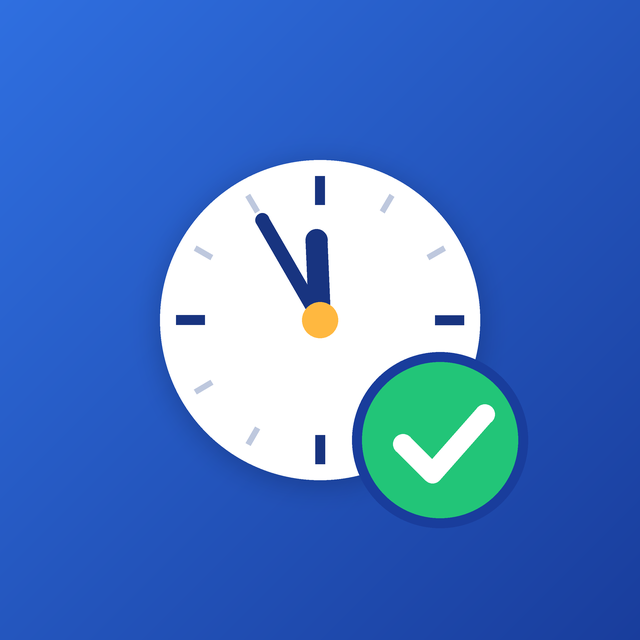
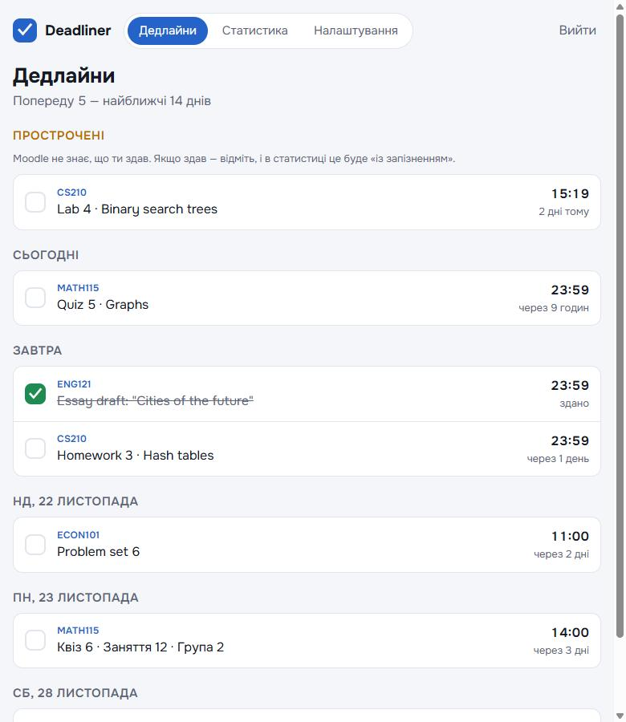
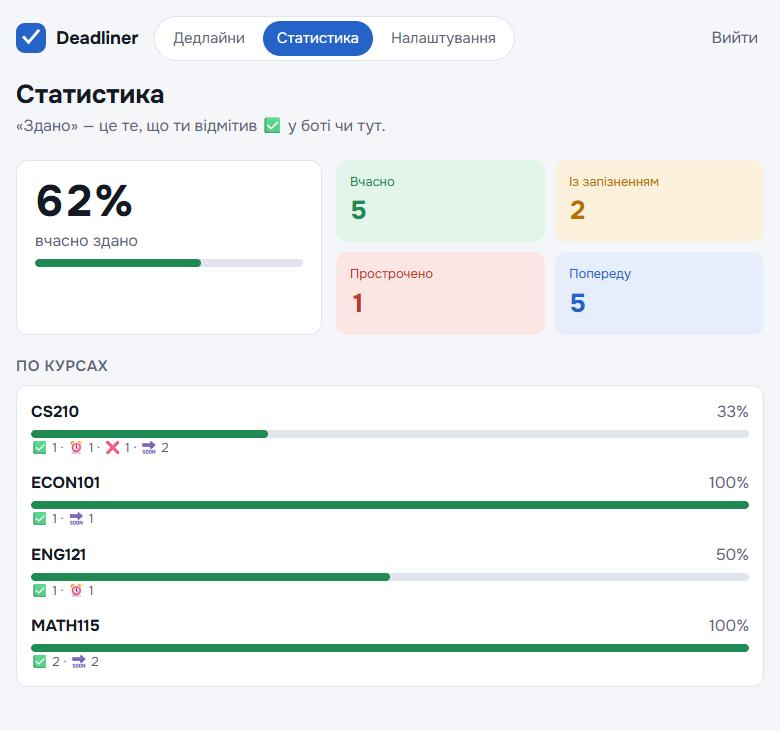
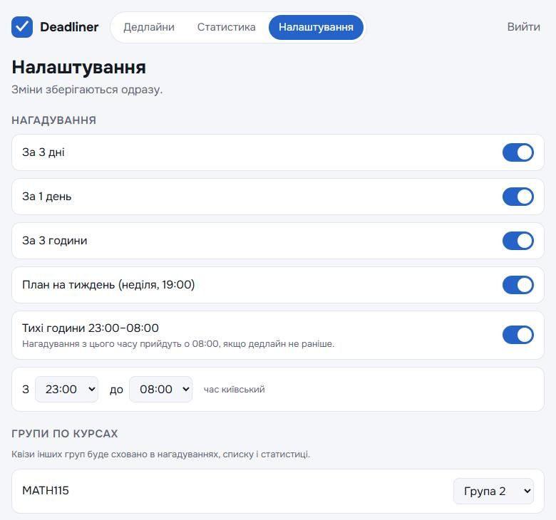
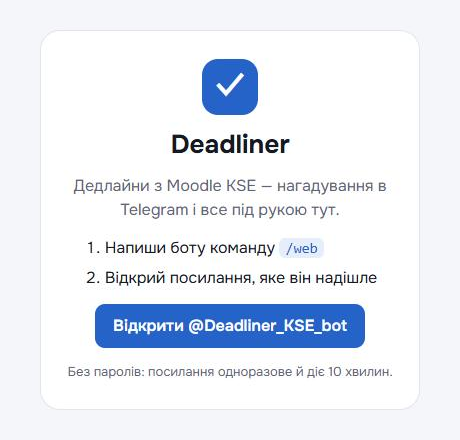

<p align="center">
  
</p>

<h1 align="center">Deadliner</h1>

<p align="center">
  A Telegram bot and web dashboard that remind <a href="https://kse.ua">Kyiv School of Economics</a> students about their Moodle deadlines.<br>
  <a href="https://github.com/dexipua/deadliner/actions/workflows/ci.yml"></a>
  
  
  
  
</p>

<p align="center">
  
  
</p>

## Why

Moodle shows deadlines, but nobody opens Moodle at 22:00 to check what is due at 23:59. Deadliner reads each student's Moodle calendar and reminds them in Telegram, where they already are. I built it for myself and my classmates at KSE.

## What it does

Paste your Moodle calendar link into the bot once. Then Deadliner:

- reminds you **3 days, 1 day and 3 hours** before each deadline, each reminder exactly once;
- sends a **plan for the week** every Sunday at 19:00;
- keeps **quiet hours** you choose (23:00–08:00 by default): reminders that fall inside arrive when they end, unless the deadline is earlier;
- lets you tap **✅ Done**, **↩️ Undo** or **⏰ +1 hour** right under a reminder;
- hides quizzes of **other seminar groups** once you pick your group in each course;
- shows **stats**: handed in on time, late, overdue, per course;
- has a **web dashboard**: send `/web`, open the one-time link, no password.

| Bot command | What it does |
|---|---|
| `/start`, `/help` | How to connect your Moodle calendar |
| `/deadlines` | The next 7 days and recent overdue, with ✅ buttons |
| `/stats` | On time / late / overdue / upcoming, per course |
| `/group` | Your seminar group in each course |
| `/settings` | Reminder times, weekly plan, quiet hours |
| `/web` | A login link for the web dashboard |
| `/logout` | End all web dashboard sessions |
| `/stop` | Delete all your data |

<p align="center">
  
  
</p>

## How it works

```
Telegram ⇄ Spring Boot app ─┬─ bot (long polling) ── CommandHandler ── DeadlineActions
                            ├─ /api + React dashboard (session from a one-time /web link)
                            ├─ sync job, every 30 min: each user's Moodle iCal feed → PostgreSQL
                            ├─ reminder job, every minute: ReminderPlanner → one merged message per user
                            └─ digest job, Sunday 19:00 Kyiv time
```

A few decisions worth a look (details in [the design doc](docs/superpowers/specs/2026-11-19-deadliner-design.md)):

- **Exactly-once reminders.** Every sent reminder is stored as `(deadline, offset, due date)`. A moved deadline gets new reminders; a restart or a failed send never duplicates or loses one inside a 30-minute window.
- **No burst on sign-up.** Connecting 2 hours before a deadline does not fire the old "3 days left" and "1 day left" reminders.
- **A Moodle outage is not a broken link.** Timeouts and 5xx don't count toward the "your link stopped working" warning; only invalid feeds and 4xx do.
- **One user's failure never stops the jobs** for everyone else, and a user who blocks the bot is deactivated.
- **Same rules everywhere.** The bot and the web API share `DeadlineActions`, so "done", "undo" and "snooze" behave identically.

## Privacy and security

- The calendar link contains a personal token. It is stored **encrypted (AES-GCM)**, never logged, and the bot deletes the message with it from the chat.
- Web login uses one-time links (10 minutes, single use) and sessions in an HttpOnly, SameSite=Lax cookie; both are random tokens stored only as SHA-256 hashes. Changes require a CSRF header; pages can't be framed.
- Only deadlines are stored (course, title, due date). Telegram names are not stored. `/stop` deletes everything.

## Tech

**Backend:** Java 21, Spring Boot 4.1, Spring MVC, Spring Data JPA, PostgreSQL 16, Flyway, ical4j, TelegramBots 10<br>
**Frontend:** React 19, TypeScript, Vite<br>
**Quality:** 183 tests — JUnit 5, AssertJ, Mockito, Testcontainers (real PostgreSQL), MockMvc; two independent code reviews; GitHub Actions<br>
**Ops:** Docker multi-stage image (bot + API + dashboard), Docker Compose with daily `pg_dump` backups

## Run it

Requirements: JDK 21, Node 22, Docker.

```bash
cp .env.example .env          # TELEGRAM_BOT_TOKEN from @BotFather, DEADLINER_FEED_KEY = openssl rand -base64 32
./run-local.ps1               # builds the dashboard once, starts PostgreSQL and the app on :8080
./mvnw verify                 # all tests (needs Docker)
```

For frontend work, `cd web && npm run dev` serves the dashboard with hot reload on :5173. Production: [docs/deploy.md](docs/deploy.md).

## Project layout

```
src/main/java/ua/dexipua/deadliner/
  feed/       link validation, encryption, iCal parsing, sync
  deadline/   deadlines, actions (done/undo/snooze), groups, stats
  reminder/   reminder planning, quiet hours, reminder + digest jobs, message texts
  bot/        Telegram commands and wiring
  web/        login links, sessions, REST API
  user/       users
web/          React dashboard
docs/         design, plans, deploy guide, screenshots, brand
```

## Status

Version 1.3.0 — see the [changelog](CHANGELOG.md). Next: hosting it for classmates.

Made by [Artem Moseichenko](https://www.linkedin.com/in/artem-moseichenko/) · [portfolio](https://dexipua.github.io/)
